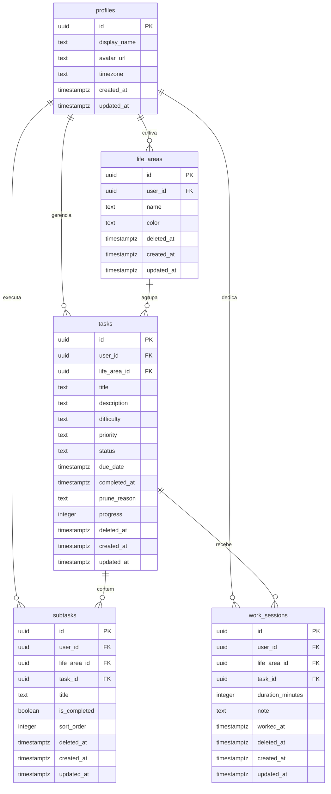

# TaskGarden — Gestão de Tarefas Gamificada

O **TaskGarden** é uma aplicação web de gestão de tarefas com uma interface gamificada baseada no crescimento de plantas.

🔗 **Produção:** [https://taskgarden-rho.vercel.app](https://taskgarden-rho.vercel.app)

---

## 📋 Status de Desenvolvimento dos Módulos

O projeto foi dividido em módulos estruturados e incrementais de desenvolvimento:

| Módulo | Funcionalidades Principais | Status |
| :--- | :--- | :--- |
| **M1 — Auth & Perfis** | Autenticação e cadastro via Supabase SSR, perfis de usuário com timezone. | Concluído ✅ |
| **M2 — Áreas & Tarefas** | Criação de Áreas da Vida e Tarefas reais (sementes) vinculadas, listagem dinâmica. | Concluído ✅ |
| **M3 — Sessões & Tempo** | Registro de sessões de trabalho real-time, dedicação em minutos e ganho de esforço. | Concluído ✅ |
| **M4 — Foco & Pomodoro** | Timer Pomodoro integrado com bloqueios, metas de sessão e registro de tempo. | Concluído ✅ |
| **M5 — Subtarefas & Progresso** | Subtarefas com controle individual, progresso calculado automaticamente de 0% a 100%. | Concluído ✅ |
| **M6 — Polish, UX & A11y** | Estados vazios inteligentes, feedback de loading, acessibilidade (aria-labels) e portfólio. | Concluído ✅ |
| **M7 — Deploy & Produção** | Deploy na Vercel, variáveis de ambiente de produção e configuração Supabase Auth redirects. | Concluído ✅ |
| **M9 — Pendências globais** | Visão unificada das pendências de todas as áreas. | Concluído ✅ |
| **M10 — Agenda global** | Agenda com tarefas, rotinas e eventos de todas as áreas. | Concluído ✅ |
| **M10.2–10.4 — Rotinas e eventos** | Rotinas recorrentes (diária, dias úteis, semanal, mensal), conclusão por período, edição e eventos pontuais. | Concluído ✅ |
| **M11 — Crescimento visual** | Estágios e tamanho da árvore conforme o esforço acumulado. | Concluído ✅ |
| **M12 — Branding & login** | Identidade visual e telas de autenticação. | Concluído ✅ |
| **M13 — PWA** | Manifesto e ícones para instalar o app no celular. | Concluído ✅ |

---

## 🌿 Conceito de Cultivo

Neste projeto, a gamificação é orientada pela seguinte estrutura conceitual:
- **Uma árvore representa uma área da vida.** (Ex: Igreja, Trabalho, Academia, Estudos, Vida pessoal, Projetos).
- **As tarefas pertencem a essa área.** Elas são cadastradas e concluídas de forma vinculada a cada árvore.
- **A árvore cresce com o tempo e os resultados acumulados.** O estágio da árvore (`stage`) e seu tamanho visual (`visualSize`) refletem a dedicação de tempo focado e o histórico acumulado de tarefas colhidas nessa área ao longo dos dias.
- **Criar novas tarefas não reduz a árvore.** O progresso das tarefas abertas atuais (`currentProgress`) é exibido como uma barra horizontal informativa secundária. Adicionar novas tarefas diminui o progresso da barra (já que há mais trabalho pendente), mas a árvore preserva seu tamanho e estágio integralmente, pois o esforço histórico acumulado nunca decresce.

---

## 🚀 Como Executar o Projeto Localmente

### Pré-requisitos
- Node.js instalado (v18+)
- Gerenciador de pacotes `npm`

### 1. Clonar o projeto
```bash
git clone https://github.com/rxguzzo/taskgarden.git
cd taskgarden
```

### 2. Instalar as Dependências
Instale os pacotes necessários rodando:
```bash
npm install
```

### 3. Configurar as variáveis de ambiente (Supabase)
O app precisa de um projeto Supabase para rodar (autenticação e banco).

1. Copie o arquivo de exemplo:
   ```bash
   cp .env.example .env.local
   ```
2. Preencha com os dados do seu projeto Supabase (Project Settings → API):

| Variável | Para quê |
| --- | --- |
| `NEXT_PUBLIC_SUPABASE_URL` | URL do projeto Supabase |
| `NEXT_PUBLIC_SUPABASE_PUBLISHABLE_KEY` | Chave pública (anon/publishable) — segura no navegador porque o RLS protege os dados |
| `NEXT_PUBLIC_SITE_URL` | URL do app (`http://localhost:3000` em desenvolvimento) |

3. Aplique as migrations do banco (seção abaixo) e rode `npm run dev`.

> Sem as variáveis, o app avisa o erro ao iniciar: não existe modo de demonstração sem banco.

---

## 🗄️ Arquitetura do Banco de Dados & Supabase

### Modelo Entidade-Relacionamento (ER)

O banco de dados é modelado com base nas relações entre o perfil do usuário, suas áreas de cultivo (Áreas da Vida), as sementes (Tarefas) e subtarefas, além do histórico de esforço dedicado:



### Provisionamento & RLS (Row Level Security)

As políticas de RLS, permissões (grants/revokes) e triggers de atualização automática do banco de dados no Supabase Cloud **são provisionadas integralmente pelas migrations do projeto**, localizadas em `supabase/migrations/`.

Para aplicar e atualizar a infraestrutura de banco de dados, você deve utilizar a Supabase CLI:
```bash
# Vincular ao projeto Supabase remoto
npx supabase link --project-ref <seu-project-ref>

# Enviar e aplicar as migrations locais
npx supabase db push
```

> [!IMPORTANT]
> Nunca altere ou configure as políticas RLS manualmente pelo console do Supabase. A infraestrutura do banco de dados é declarativa e orientada pelas migrações versionadas no repositório.

---

## ☁️ Guia de Deploy em Produção (Vercel & Supabase)

### 1. Configurando Variáveis de Ambiente na Vercel
Ao importar o repositório `rxguzzo/taskgarden` no painel da Vercel, configure as seguintes variáveis públicas em **Environment Variables**:
* `NEXT_PUBLIC_SUPABASE_URL`: `https://seu-projeto-id.supabase.co`
* `NEXT_PUBLIC_SUPABASE_PUBLISHABLE_KEY`: `sua-chave-anonima-publica`

> [!CAUTION]
> **Aviso de Segurança:** Nunca utilize a chave `service_role` ou strings de conexão direta com senha do banco de dados nas variáveis de ambiente expostas no frontend. O cliente Supabase deve usar apenas as chaves públicas configuradas acima.

### 2. Configurações de URL no Supabase Auth
No painel do Supabase, vá em **Authentication** $\rightarrow$ **URL Configuration** e configure:
* **Site URL**: `https://taskgarden-rho.vercel.app` (o domínio de produção atribuído pela Vercel)
* **Redirect URLs** (Adicione as seguintes URLs autorizadas na lista):
  * `https://taskgarden-rho.vercel.app/auth/callback`
  * `https://taskgarden-rho.vercel.app/redefinir-senha`
  * `http://localhost:3000/auth/callback` *(preserva suporte ao desenvolvimento local)*
  * `http://localhost:3000/redefinir-senha` *(preserva suporte ao desenvolvimento local)*

---

## 🛠️ Comandos de Verificação e Qualidade

Antes de enviar alterações para produção, execute os comandos de qualidade do código:

- **Linting**: Validação de estilo e checagem estática com ESLint:
  ```bash
  npm run lint
  ```
- **Typecheck**: Verificação estática de tipos do TypeScript:
  ```bash
  npx tsc --noEmit
  ```
- **Compilação**: Executar o build completo do Next.js de produção para garantir integridade:
  ```bash
  npm run build
  ```

---

## 📂 Estrutura de Pastas Implementada

```text
src/
├── app/                      # Rotas e Páginas do Next.js App Router
│   ├── (auth)/               # Grupo de rotas de login/cadastro
│   │   ├── cadastro/         # Página de cadastro provisória
│   │   ├── login/            # Página de login provisória
│   │   └── layout.tsx        # Layout isolado de autenticação
│   ├── (dashboard)/          # Grupo de rotas do painel
│   │   ├── focus/            # Tela de cronômetro Pomodoro (provisória)
│   │   ├── garden/           # Dashboard principal do Jardim Digital
│   │   │   ├── [areaId]/     # Detalhe dinâmico da Área da Vida
│   │   │   └── page.tsx      # Jardim exibindo o grid de Áreas
│   │   ├── greenhouse/       # Estufa de histórico (tarefas arquivadas/podadas)
│   │   ├── settings/         # Configurações de tema e chaves do Supabase
│   │   ├── statistics/       # Gráficos de tempo focado e progresso
│   │   ├── tasks/            # Página para plantar novas tarefas
│   │   └── layout.tsx        # Layout principal com Sidebar e BottomNav responsivo
│   ├── globals.css           # Estilização global e animações (Sway do vento)
│   ├── layout.tsx            # Layout raiz global (Head e body)
│   └── page.tsx              # Redirecionador inicial (/ -> /garden)
├── components/               # Componentes React Reutilizáveis
│   ├── layout/               # Elementos de navegação responsivos
│   │   ├── BottomNav.tsx     # Menu de navegação mobile
│   │   └── Sidebar.tsx       # Menu de navegação desktop
│   ├── plants/               # Componente de representação dinâmica
│   │   └── PlantVisual.tsx   # SVG inline dinâmico isolado de lógica
│   └── ui/                   # Wrappers e elementos gráficos base
│       └── Card.tsx          # Card com efeito Glassmorphism
├── config/                   # Configurações globais e centrais
│   └── navigation.ts         # Lista centralizada de rotas de navegação
├── domain/                   # Camada de Regras e Modelagem de Negócio
│   └── growth/               # Lógica pura de crescimento e mapeamento de estágios
│       ├── rules.ts          # Funções puras (Progresso -> Estágio -> Tamanho)
│       └── types.ts          # Tipos (DemoLifeArea, DemoAreaTask)
│   ├── demo-life-areas.ts    # Lista estática de áreas da vida (Igreja, Trabalho, etc.)
│   └── demo-area-tasks.ts    # Lista estática de tarefas vinculadas às áreas
├── services/                 # Serviços de Integração Externa
│   └── supabase/             # Clientes Supabase com verificação segura
│       ├── browser.ts        # Cliente do lado do navegador
│       ├── server.ts        # Cliente do lado do servidor
│       └── config.ts         # Validador de variáveis de ambiente
└── utils/                    # Utilitários gerais
    └── date.ts               # Formatação de datas em padrão brasileiro
```
